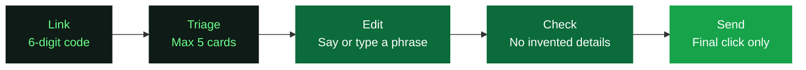
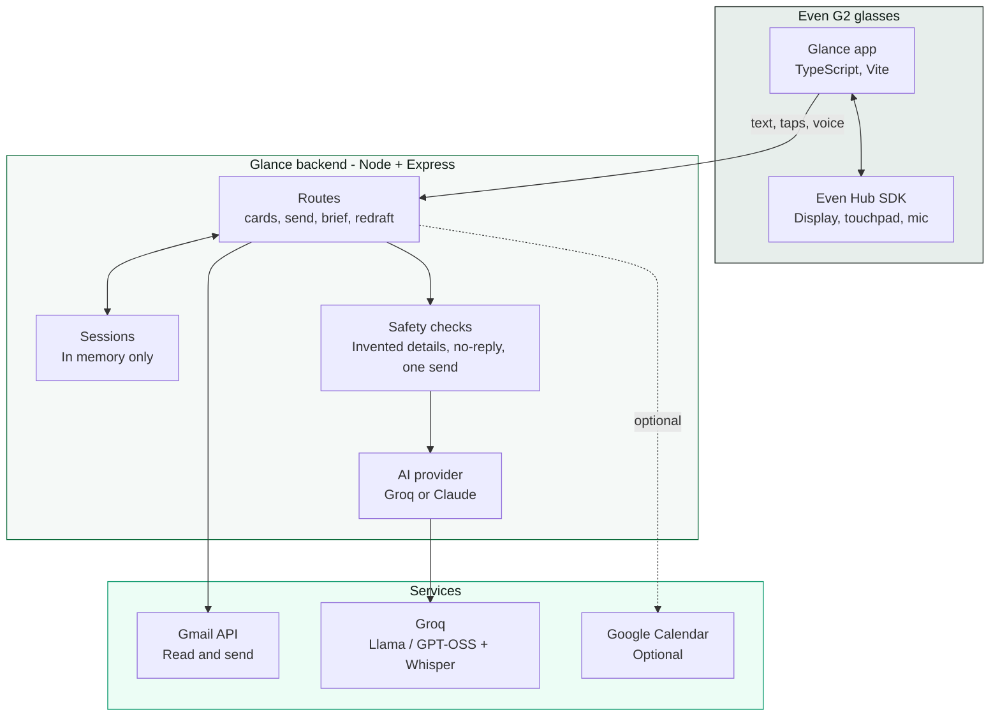
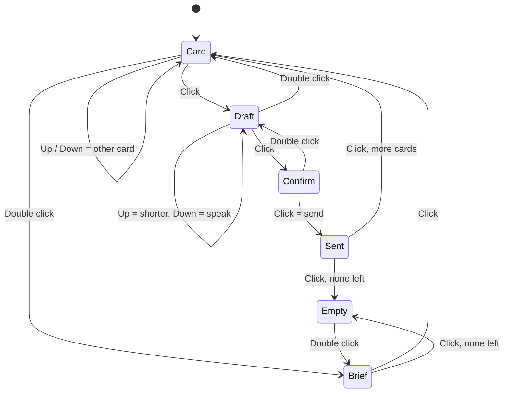
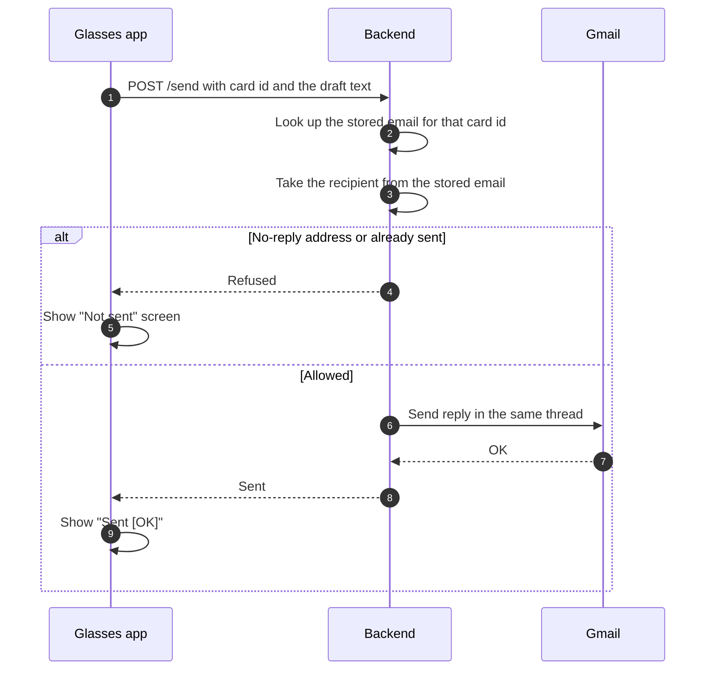
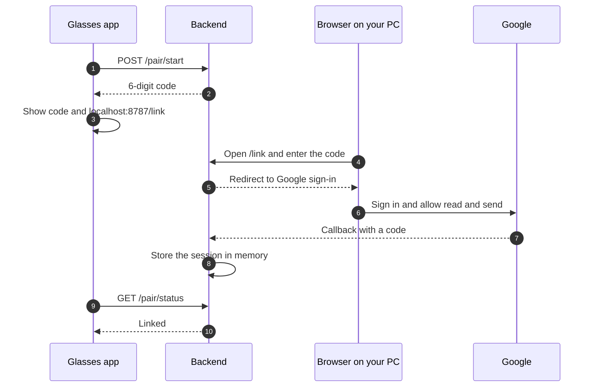
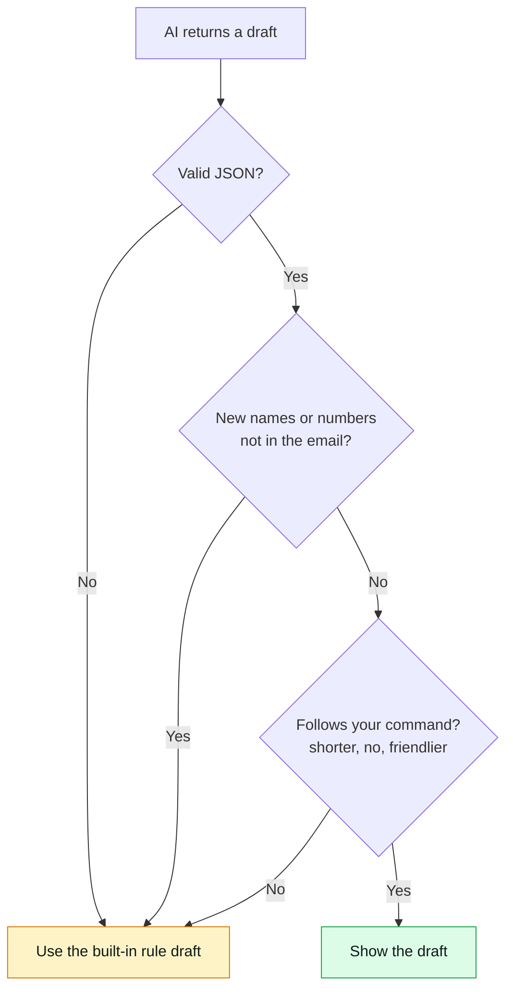
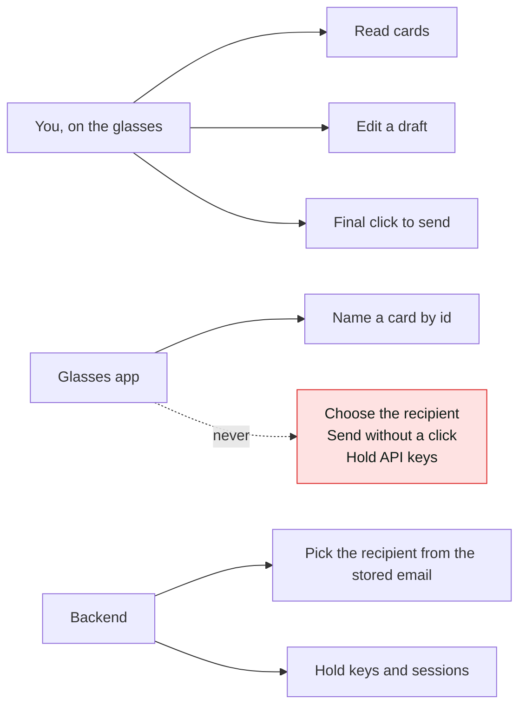

<div align="center">


# Glance

### Inbox zero, eyes up.

**The few emails that need you, one per screen on Even G2 smart glasses. The reply is already written. Tap to send, or say what to change.**

<br />

[](https://hajrajadoon.github.io/glance-g2/)


<br />

**[Website](https://hajrajadoon.github.io/glance-g2/)** · **[Getting Started](#getting-started)** · **[How It Works](#how-glance-works)** · **[Safety](#safety-and-privacy)** · **[FAQ](https://hajrajadoon.github.io/glance-g2/#faq)**

</div>

---

## Table of Contents

- [Overview](#overview)
- [Live Deployment](#live-deployment)
- [The Problem and Our Solution](#the-problem-and-our-solution)
- [Key Features](#key-features)
- [How Glance Works](#how-glance-works)
- [Controls](#controls)
- [System Architecture](#system-architecture)
- [Workflow Diagrams](#workflow-diagrams)
  - [Screen Flow](#screen-flow)
  - [Sending a Reply](#sending-a-reply)
  - [Signing In Without a Browser](#signing-in-without-a-browser)
  - [Checking an AI Draft](#checking-an-ai-draft)
  - [Who Can Do What](#who-can-do-what)
- [Voice and Typed Commands](#voice-and-typed-commands)
- [Tech Stack](#tech-stack)
- [Project Structure](#project-structure)
- [Getting Started](#getting-started)
  - [Prerequisites](#prerequisites)
  - [Run the Demo](#run-the-demo)
  - [Free AI and Voice (Groq)](#free-ai-and-voice-groq)
  - [Real Gmail](#real-gmail)
  - [Google Calendar Brief](#google-calendar-brief)
  - [Package for Even Hub](#package-for-even-hub)
  - [Environment Variables](#environment-variables)
- [Backend API](#backend-api)
- [Hosting the Website](#hosting-the-website)
- [Safety and Privacy](#safety-and-privacy)
- [Limitations](#limitations)
- [Roadmap](#roadmap)
- [Disclaimer](#disclaimer)
- [Contributing](#contributing)
- [License](#license)
- [Author](#author)

---

## Overview

Email pulls you out of the moment. You are walking to a meeting, so you either ignore your inbox or take out your phone, scroll past newsletters and type with your thumbs.

**Glance** is an email assistant for **Even G2 smart glasses**. It works in four steps that take about thirty seconds:

1. **See only what needs you.** AI reads your unread Primary mail and keeps at most five that need a person. Newsletters, promotions and alerts never appear.
2. **The reply is already written.** Every card comes with a short draft based on the email itself.
3. **Change it in a phrase.** Say or type "shorter" or "say no politely". The draft is rewritten in seconds.
4. **Click to send.** Nothing leaves your inbox without the final click.

Before a meeting, one double click shows who you are meeting, the last thread with them and one question to ask.

> Walking to a meeting, you answer your email without taking out your phone.

---

## Live Deployment

| Component | Where | Link |
|---|---|---|
| **Website** (landing page with a working glasses display) | GitHub Pages | [hajrajadoon.github.io/glance-g2](https://hajrajadoon.github.io/glance-g2/) |
| **Glasses app** | Even Hub simulator, or packaged as `glance.ehpk` | See [Getting Started](#getting-started) |
| **Backend** (AI, Gmail, sessions) | Runs on your machine | `npm run server` → `http://localhost:8787` |

> **Note:** Glance is tested in the Even Hub simulator. It has not been tested on physical G2 hardware yet. The backend runs on your own computer, so the keys never leave it.

---

## The Problem and Our Solution

**The problem**

- A phone pulls your eyes and hands away from what you are doing.
- Most unread mail does not need you, but you still have to read it to know that.
- Writing a reply with your thumbs takes longer than the reply itself.
- An AI that writes and sends mail for you can make mistakes you only find later.

**Our solution:** Glance decides what to show, writes the reply, and leaves the last decision with you.

| Need | How Glance addresses it |
|---|---|
| Hands and eyes free | One short card per screen, big text, a touchpad on the glasses |
| Less noise | At most five cards. Promotions, social and alerts are skipped. |
| Fast replies | A draft is ready on every card, and one phrase changes it |
| Trust the AI | Invented names and numbers are caught and replaced by a safe reply |
| No accidents | Sending needs a final click. The server picks the recipient. |
| Works when AI fails | Built-in rules write the draft if the AI is down or answers badly |

---

## Key Features

- **Triage:** at most five cards per run. Gmail query is unread, in Inbox, and not in Promotions, Social, Updates or Forums.
- **AI drafts:** written from the email itself, under 35 words, in the first person.
- **Voice edits:** press Down on a draft, say what to change, press again. Speech to text uses Whisper.
- **Typed commands:** the same commands work from a box on the app page, so you can test without a microphone.
- **Meeting brief:** who is in the meeting, the last thread with them and a question to ask.
- **Demo mode:** no keys and no login needed. Click on the link screen to use a built-in inbox. Nothing is sent in demo mode.
- **Pairing code sign-in:** Google blocks its sign-in inside the glasses WebView, so the glasses show a 6-digit code and you finish on a normal web page.
- **Model fallback:** if a Groq model is not available on your account, the server tries the next one automatically.
- **Offline fallbacks:** rule-based triage, drafts and redrafts keep the app working without AI.
- **39 automated tests** for the screen logic, the safety checks, the AI providers and the Gmail routes.

---

## How Glance Works

A clear path from your inbox to a sent reply.

| Step | Stage | Description |
|:---:|---|---|
| **1** | **Link** | The glasses show a 6-digit code. You enter it at `localhost:8787/link` and sign in with Google. |
| **2** | **Triage** | The server reads unread Primary mail. AI keeps at most five that need a person and writes a one-line gist and a draft for each. |
| **3** | **Edit** | You say or type a short phrase. The draft is rewritten and checked before it is shown. |
| **4** | **Send** | You click twice (open the draft, then confirm). The server sends the reply to the sender of the original email. |



---

## Controls

| Screen | Click | Double click | Up | Down |
|---|---|---|---|---|
| **Card** | Open the draft | Meeting brief | Previous card | Next card |
| **Draft** | Go to confirm | Back | Make it shorter | Speak a command |
| **Confirm** | **Send** | Back | – | – |
| **Sent** | Next card | – | – | – |
| **Inbox zero** | – | Next meeting | – | – |
| **Brief** | Back | – | – | – |

On the glasses, Up and Down are swipes on the temple touchpad.

---

## System Architecture

Glance is a small web app inside the Even Hub WebView, plus a Node backend that holds the keys and talks to Gmail and the AI.



### Components

| Component | Responsibility |
|---|---|
| **Glance app** (`src/`) | Draws text screens, runs the screen state machine, reads taps and the microphone |
| **SDK adapter** (`src/glasses.ts`) | The only file that calls the Even Hub SDK |
| **Backend routes** (`server/google.ts`, `server/index.ts`) | Pairing, sign-in, cards, send, brief, redraft, speech to text |
| **Safety checks** (`server/lib.ts`) | Clean the emails, guard the AI output, build safe replies |
| **AI providers** (`server/providers.ts`) | Groq with model fallback, optional Claude, offline rules |
| **Gmail client** (`server/gmail.ts`) | Reads unread Primary mail and builds the reply message |
| **Sessions** (`server/session.ts`) | Pairing codes and sign-in tokens, held in memory |

---

## Workflow Diagrams

### Screen Flow

What each input does on each screen.



### Sending a Reply

What happens from the confirm screen to the sent email.



### Signing In Without a Browser



### Checking an AI Draft

Every draft passes these checks before you see it.



The email text is always passed to the AI as untrusted data. Instructions hidden inside an email are ignored.

### Who Can Do What



---

## Voice and Typed Commands

| You say or type | What happens |
|---|---|
| `shorter` | The draft is cut down |
| `say no politely` / `decline` | A polite refusal, with no invented excuse |
| `more friendly` | A warmer version of the draft (any other instruction works the same way) |
| `send it` | Opens the confirm screen. It does **not** send. |
| `back` / `skip` / `cancel` | Goes back to the card |

Anything else is treated as an instruction for rewriting the draft, and the result goes through the same checks. The input box is on the app page (`http://localhost:5173`), and the microphone path records up to 8 seconds.

---

## Tech Stack

| Layer | Technology |
|---|---|
| **Glasses app** | TypeScript, Vite 7, Even Hub SDK (`@evenrealities/even_hub_sdk`) |
| **Display** | 576 x 288 monochrome green text screens, about 34 columns |
| **Backend** | Node.js 20+, Express 5, TypeScript run with `--experimental-strip-types` |
| **AI** | Groq (free tier): Llama and GPT-OSS with model fallback. Optional Claude. Offline rules as a last resort. |
| **Speech** | Groq Whisper (`whisper-large-v3-turbo`) |
| **Mail** | Gmail API (`gmail.readonly`, `gmail.send`), optional Calendar (`calendar.readonly`) |
| **Tests** | Node's built-in test runner, 39 tests |
| **Website** | Static HTML on GitHub Pages |

---

## Project Structure

```text
glance-g2/
├── src/                      Glasses app
│   ├── state.ts              Screens, reducer, text rendering
│   ├── glasses.ts            The only file that uses the Even Hub SDK
│   ├── api.ts                Backend client
│   ├── main.ts               App flow, recording, send
│   ├── mock.ts               Demo inbox and brief
│   └── state.test.ts
├── server/                   Backend
│   ├── index.ts              Server, AI routes, speech to text
│   ├── google.ts             Pairing, sign-in, cards, send, brief
│   ├── gmail.ts              Gmail client
│   ├── calendar.ts           Calendar client (optional)
│   ├── session.ts            In-memory sessions
│   ├── providers.ts          AI providers and fallback chain
│   ├── lib.ts                Prompts, safety checks, offline fallbacks
│   ├── mails.ts              Demo mails
│   └── *.test.ts
├── docs/                     Website and guides (GitHub Pages)
│   ├── index.html            Landing page
│   ├── logo.svg
│   ├── favicon.svg
│   ├── social-preview.png
│   ├── GITHUB.md             How to publish
│   ├── SUBMISSION.md         Submission kit
│   └── VIDEO_SCRIPT.md       Demo video script
├── app.json                  Even Hub package manifest
├── index.html                Glasses app page
├── package.json
├── .env.example
├── LICENSE
└── README.md
```

---

## Getting Started

### Prerequisites

- **Node.js** 20 LTS or newer, with npm
- **Git**
- The Even Hub tools: `@evenrealities/evenhub-cli` and `@evenrealities/evenhub-simulator`
- On Windows, the **WebView2 runtime** for the simulator (`winget install Microsoft.EdgeWebView2Runtime`)
- Optional: a free **Groq** key, and a **Google Cloud** project for real Gmail

### Run the Demo

No keys, no login, nothing to configure:

```bash
npm install -g @evenrealities/evenhub-cli @evenrealities/evenhub-simulator
npm install
npm test                 # 39 tests
copy .env.example .env   # Windows. On Mac/Linux: cp .env.example .env
npm run server           # terminal 1 -> http://localhost:8787
npm run dev              # terminal 2 -> http://localhost:5173
npm run sim              # terminal 3: opens the G2 simulator
```

On the "Link Gmail" screen, click once to use the built-in demo inbox (Sara, Ali, Maria and Dad).

### Free AI and Voice (Groq)

1. Create a free key at [console.groq.com/keys](https://console.groq.com/keys). No card is needed.
2. Put it in `.env` as `GROQ_API_KEY=...` and restart `npm run server`.
3. The server prints which AI and voice it is using. If a model is not available on your account, it moves to the next one in the chain.

Typed commands work without a microphone: use the box on the app page.

### Real Gmail

1. **Google Cloud Console:** create a project and enable the **Gmail API**.
2. **Google Auth Platform:** choose External, add the scopes `gmail.readonly` and `gmail.send`, and add your Gmail as a **test user**.
3. **Credentials:** create an **OAuth client ID** (Web application) with the redirect URI `http://localhost:8787/auth/callback`.
4. Put `GOOGLE_CLIENT_ID` and `GOOGLE_CLIENT_SECRET` in `.env` and restart the server. It prints `Gmail : ready`.
5. Start the app. The glasses show a code. Open `http://localhost:8787/link`, enter it and sign in.
6. In Testing mode Google shows an "unverified app" notice. Choose **Advanced**, then continue, and tick **all** permission boxes (including send).

To test sending safely, email **yourself**, mark the message unread, and reply from Glance.

### Google Calendar Brief

Enable the Calendar API, add `calendar.readonly` to the scopes, and set `GOOGLE_CALENDAR=1`. Without it, the brief shows demo data in demo mode and is hidden for linked accounts.

### Package for Even Hub

```bash
npm run build
npm run pack             # writes glance.ehpk
```

Before running on real glasses, point `VITE_API_URL` and the `network` whitelist in `app.json` at your hosted backend. The default whitelist is `http://localhost:8787`, which only works in the simulator.

### Environment Variables

> Never commit `.env`. It is already listed in `.gitignore`. If a key appears in a screenshot or chat, create a new one.

| Variable | Required | Description |
|---|---|---|
| `GROQ_API_KEY` | No | Free key for AI drafts and Whisper. **Secret.** |
| `ANTHROPIC_API_KEY` | No | If set, Claude writes the drafts instead of Groq. **Secret.** |
| `GOOGLE_CLIENT_ID` | Real Gmail | OAuth client ID |
| `GOOGLE_CLIENT_SECRET` | Real Gmail | OAuth client secret. **Secret.** |
| `GOOGLE_CALENDAR` | No | `1` turns on the real meeting brief (needs the Calendar API and scope) |
| `PORT` | No | Default `8787` |
| `DEMO` | No | `1` forces offline mode (no AI, no voice calls) |
| `GROQ_MODEL` | No | Preferred Groq model. Default chain: `llama-3.1-8b-instant`, `openai/gpt-oss-20b`, `openai/gpt-oss-120b`, `llama-3.3-70b-versatile` |
| `STT_MODEL` | No | Default `whisper-large-v3-turbo` |
| `STT_LANGUAGE` | No | Default `en` |
| `VITE_API_URL` | Packaging | Backend address the packaged app calls |

---

## Backend API

The backend's routes:

| Method | Endpoint | Description |
|---|---|---|
| `GET` | `/health` | Which AI, voice and Gmail are active |
| `POST` | `/pair/start` | Start pairing and return a 6-digit code |
| `GET` | `/pair/status` | Whether the code has been linked |
| `GET` | `/link` | Web page where you enter the code |
| `GET` | `/auth/start` | Begin Google sign-in |
| `GET` | `/auth/callback` | Google sign-in callback |
| `GET` | `/session` | Whether the current session is linked |
| `GET` | `/cards` | Triage unread Primary mail into cards |
| `POST` | `/send` | Send a reply for one card (card id and text only) |
| `GET` | `/brief` | Meeting brief |
| `POST` | `/triage` | Triage mail sent in the request (demo and testing) |
| `POST` | `/redraft` | Rewrite a draft from a command |
| `POST` | `/transcribe` | Speech to text for recorded audio |

The session token travels in the `X-Session` header.

---

## Hosting the Website

The `docs/` folder is a static website.

| Platform | Settings |
|---|---|
| **GitHub Pages** | Settings → Pages → Deploy from a branch → `main` / `/docs` |
| **Vercel** | Import the repo → Root Directory `docs` → Framework *Other* → no build command |
| **Netlify** | Publish directory `docs` → no build command |

The backend is a long-running process with in-memory sessions and secret keys, so it is not a fit for static or serverless hosting. Use a small always-on host if you want it online.

---

## Safety and Privacy

| Actor | Can | Cannot |
|---|---|---|
| **You** | Read cards, edit drafts, send with the final click | – |
| **Glasses app** | Name a card by id, show screens | Choose the recipient, hold API keys, send without a click |
| **Backend** | Pick the recipient from the stored email, call Gmail and the AI | Delete, archive or change mail |
| **AI** | Suggest a draft | Send anything. Its output is checked before you see it. |

- **No send without a click.** Voice can open the confirm screen ("send it") but cannot send.
- **The glasses never choose the recipient.** The app only names a card. No-reply addresses are refused and each reply can be sent only once. At most 50 sends per run.
- **Invented details are blocked.** If a draft contains a name or number that is not in the email, or ignores your instruction, it is discarded and replaced by a safe reply.
- **Emails are untrusted text.** Instructions inside an email are not followed.
- **Safe message building.** The reply is built so that a crafted subject or address cannot inject headers.
- **Minimal data.** Only the Gmail read and send permissions are requested (plus Calendar read if you turn it on). Emails are never written to disk. Sessions live in server memory. API keys stay on the backend.

---

## Limitations

- **Simulator only so far:** Glance has not been tested on physical G2 glasses.
- **Local backend:** the packaged app calls `localhost`, so on real glasses you need a hosted backend.
- **Google Testing mode:** only listed test users can sign in, and Google shows an "unverified app" notice.
- **Primary tab only:** Promotions, Social, Updates, Forums and Spam are skipped on purpose.
- **English speech:** speech recognition is set to English.
- **Calendar is demo data** unless you enable the Calendar API and `GOOGLE_CALENDAR=1`.
- **AI can still be imperfect:** the checks catch invented names and numbers and ignored commands, but you always read the draft before sending.
- **In-memory sessions:** restarting the server unlinks Gmail.

---

## Roadmap

- [x] Card triage with at most five emails
- [x] AI drafts with offline fallbacks
- [x] Voice and typed edit commands
- [x] Pairing code sign-in for the glasses
- [x] Real Gmail read and send
- [x] Meeting brief
- [x] Demo inbox that needs no login
- [x] Landing page with a working glasses display
- [x] 39 automated tests
- [ ] Test on physical G2 glasses
- [ ] Hosted backend for the packaged app
- [ ] Voice actions beyond email: move a meeting, add a task
- [ ] More inboxes, such as Outlook

---

## Disclaimer

**Glance is a hackathon prototype.** It is an independent project and is not affiliated with or endorsed by Google, Even Realities or Groq. Review every reply before you send it, and use your own or a test account when trying real sending.

---

## Contributing

Contributions, ideas and feedback are welcome.

1. Fork the repository
2. Create a feature branch: `git checkout -b feature/your-feature`
3. Run the tests: `npm test`
4. Commit your changes: `git commit -m "Add your feature"`
5. Push to the branch: `git push origin feature/your-feature`
6. Open a Pull Request

> Never commit `.env` files or API keys.

---

## License

This project is released under the **MIT License**. See [LICENSE](LICENSE).

---

## Author

Built by **Hajrajadoon** for the **Heads Up hackathon** by Even Realities, TVM Ventures and Daos Hub (Nov 23 to 29, 2026), Track 4 · AI Assistants & Work.

---

<div align="center">

**[Website](https://hajrajadoon.github.io/glance-g2/)** · **[Getting Started](#getting-started)** · **[Safety](#safety-and-privacy)**

**Glance** · Inbox zero, eyes up.

*Hackathon prototype · Tested in the simulator*

</div>